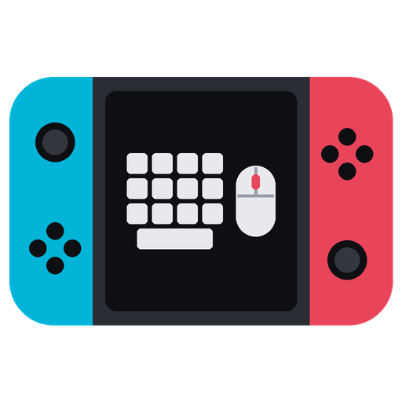
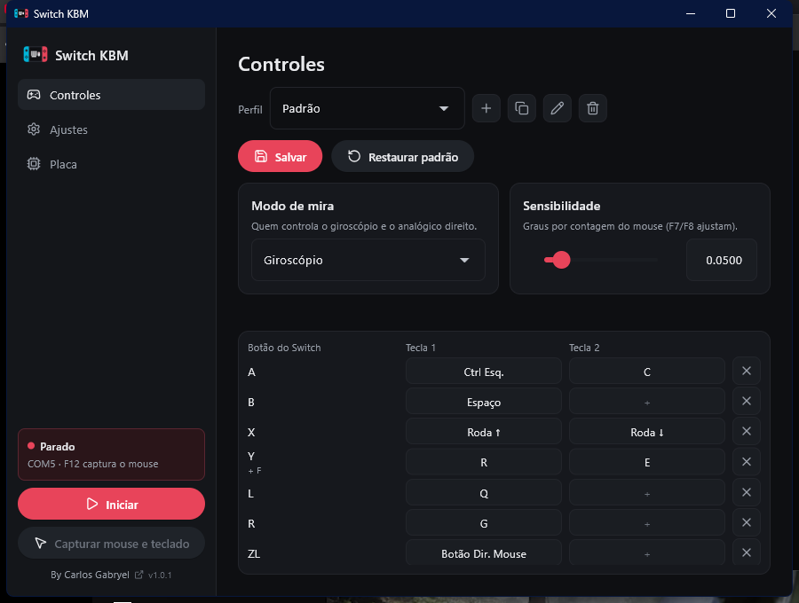

<div align="center">



# Switch KBM

**Jogue no Nintendo Switch e no Switch 2 com teclado e mouse do PC, usando uma placa ESP32 de poucos reais.**

[](https://github.com/Carlos-Gabryel/SwitchKBM/releases/latest)
[](https://github.com/Carlos-Gabryel/SwitchKBM/releases)


[](LICENSE)

[**⬇ Baixar para Windows**](https://github.com/Carlos-Gabryel/SwitchKBM/releases/latest/download/SwitchKBM.exe) ·
[**⬇ Baixar para Linux**](https://github.com/Carlos-Gabryel/SwitchKBM/releases/latest/download/SwitchKBM-x86_64.AppImage)



</div>

---

O Switch KBM transforma uma placa **ESP32** num Pro Controller. O console enxerga a placa como
um controle de verdade, e o programa no PC lê o seu teclado e o seu mouse e manda tudo para ela
pelo cabo USB. Versão atual: **1.1.0**.

## 🔍 Como funciona

```
 Teclado e mouse ──► Programa no PC ──► Cabo USB ──► Placa ESP32 ──► Bluetooth ──► Switch
                     (ou página web)                                              (vê um Pro Controller)
```

1. **O programa lê o teclado e o mouse** e transforma cada tecla, clique e movimento em comandos de
   controle (botões, analógico esquerdo, giroscópio). O mapa de teclas fica num **perfil** que você edita.
2. **Os comandos seguem pelo cabo USB** até a placa ESP32, vários por segundo.
3. **A placa conversa com o console** por Bluetooth, fingindo ser um Pro Controller original. O Switch
   não sabe que há um PC por trás: para ele é só mais um controle.
4. **O mouse vira o giroscópio** (padrão): mover o mouse gira a mira, como inclinar um controle. Com a
   tecla **F11** ele passa a ser o **analógico direito**.

Enquanto a captura está ligada, o teclado e o mouse ficam só para o jogo. **F12** sempre solta.

## ✨ O que ele faz

- **Remapeamento por perfil:** cada botão do Switch aceita até duas teclas ou botões do mouse.
- **Mouse como giroscópio ou analógico:** escolha o modo de mira e ajuste a sensibilidade.
- **Setas na mira oposta:** no modo giroscópio, as setas movem o analógico direito; no modo analógico, elas giram o giroscópio.
- **Roda do mouse como botão:** cada giro vira um toque rápido.
- **Andar devagar:** uma tecla (Alt) reduz o analógico esquerdo pela metade.
- **Captura com F12 ou com um botão:** enquanto capturado, o teclado e o mouse ficam só para o jogo. O F12 sempre solta.
- **Modo digitação (novo na 1.1.0):** escreve texto no teclado da tela do Switch, sem teclado USB. Veja [Modo digitação](#-modo-digitação).
- **Página web (novo na 1.1.0):** a mesma ideia rodando no navegador, sem instalar nada. Veja [Duas formas de usar](#-duas-formas-de-usar).
- **Prepara a placa com um clique:** o firmware vai dentro do programa, sem instalar mais nada.
- **Atualiza sozinho:** avisa quando sai versão nova.
- **Perfis por jogo:** crie, duplique e troque de perfil sem mexer em arquivos.

## 🔀 Duas formas de usar

| | **Programa (recomendado)** | Página web |
|---|---|---|
| Instalação | Baixar o `.exe` (Windows) ou o AppImage (Linux) | Nada para instalar |
| Onde roda | Windows 10/11 x64 e Linux x86_64 | Chrome, Edge ou Brave no computador, com Web Serial |
| Atraso | Menor | Pode ter um pouco mais (estimado, não medido) |
| Mouse | Lê o movimento bruto | No Linux o navegador não recebe o movimento bruto: desative a aceleração do mouse no sistema (perfil plano) |
| Teclado | Fica 100% para o jogo | Atalhos do navegador podem interferir; sem trava de teclado (Brave) o **Esc** solta a captura em vez de chegar ao Switch. No Chrome/Edge, a tela cheia com trava de teclado resolve |
| Perfis | Arquivos no computador | Ficam no navegador e podem ser exportados/importados em JSON, no mesmo formato do programa |
| Gravar a placa | **Preparar placa** | Também grava, mas **não foi testado numa placa real** |
| Atualização | Avisa sozinho | Sempre a versão mais recente da página |

Os dois têm em comum: controles e remapeamento, perfis, mira por giroscópio ou analógico, modo
digitação e gravação de firmware.

**Recomendação:** use o **programa**. A página é uma opção viável para quando não dá ou você não quer
instalar nada: [**carlos-gabryel.github.io/SwitchKBM**](https://carlos-gabryel.github.io/SwitchKBM/).
Para gravar a placa, prefira **Preparar placa** no programa, que é o caminho testado.

## 🧰 Do que você precisa

| Item | Detalhes |
|---|---|
| **Placa ESP32 original** | ESP32-WROOM / DevKit. Os modelos S2, S3, C3 e C6 **não servem**: não têm Bluetooth Classic. |
| **Cabo USB de dados** | Cabo só de carga não funciona. |
| **Windows 10/11 x64** ou **Linux x86_64** | No Windows não precisa instalar nada. No Linux veja [Linux](#-linux). |
| **Nintendo Switch ou Switch 2** | Em qualquer um dos dois a placa aparece como Pro Controller. |

## 🚀 Primeiros passos

1. **Baixe** o [`SwitchKBM.exe`](https://github.com/Carlos-Gabryel/SwitchKBM/releases/latest/download/SwitchKBM.exe) e abra.
   > Se aparecer *"O Windows protegeu o computador"*, clique em **Mais informações → Executar assim mesmo**. O programa não tem assinatura digital, que é paga.
2. **Prepare a placa:** plugue a ESP32, abra a aba **Placa**, escolha a porta e clique em **Preparar placa**. É só na primeira vez e quando sair firmware novo.
3. **Pareie no console:** no Switch, abra **Configurações do sistema → Controles e acessórios** e entre na tela de parear controles (por exemplo, **Mudar estilo/ordem**). A placa aparece como Pro Controller.
4. **Jogue:** na aba **Controles**, escolha o perfil e clique em **Iniciar**. Depois clique em **Capturar mouse e teclado** ou aperte **F12**.

Prefere não instalar nada? Os mesmos passos valem na [página web](https://carlos-gabryel.github.io/SwitchKBM/) (veja [Duas formas de usar](#-duas-formas-de-usar)).

Seus perfis e ajustes ficam em `%LOCALAPPDATA%\SwitchKBM` (no Linux, `~/.local/share/SwitchKBM`).

## 🐧 Linux

1. Baixe o [`SwitchKBM-x86_64.AppImage`](https://github.com/Carlos-Gabryel/SwitchKBM/releases/latest/download/SwitchKBM-x86_64.AppImage), dê permissão e abra:
   ```bash
   chmod +x SwitchKBM-x86_64.AppImage
   ./SwitchKBM-x86_64.AppImage
   ```
   Sem FUSE, rode com `--appimage-extract-and-run`. O AppImage se atualiza sozinho; fora dele só avisa que há versão nova.
2. **Grupo `input` (obrigatório).** O programa captura teclado e mouse de forma exclusiva lendo `/dev/input` (evdev), por isso funciona em Wayland e X11, mas o usuário precisa estar no grupo `input`:
   ```bash
   sudo usermod -aG input $USER
   ```
   Saia e entre na sessão. No **Bazzite / Fedora Atomic** rode antes: `grep -E '^input:' /usr/lib/group | sudo tee -a /etc/group`.
   Sem a permissão o programa mostra essa instrução no log em vez de capturar.
3. **Porta da placa:** entre no grupo `dialout` (`sudo usermod -aG dialout $USER`; no Fedora, `uucp` no lugar de `dialout`) **ou** instale a regra udev, que dá acesso ao usuário logado e evita o ModemManager:
   ```bash
   sudo cp packaging/linux/60-switchkbm-serial.rules /etc/udev/rules.d/
   sudo udevadm control --reload && sudo udevadm trigger
   ```
4. A porta aparece como `/dev/ttyUSB0` (CP210x/CH340) ou `/dev/ttyACM0` (USB nativa). Daí é igual ao Windows: **Placa › Preparar placa**.

Com a captura ligada o teclado e o mouse ficam exclusivos do programa (a área de trabalho não recebe nada); **F12** libera. Não há "perder o foco libera": só F12 ou o botão do app.

No **KDE com Wayland**, o programa pede ao KWin para vir para a frente ao apertar **F9**, para você ver a prévia do teclado enquanto digita.

## ⌨️ Atalhos

| Tecla | O que faz |
|---|---|
| **F7 / F8** | Diminui / aumenta a sensibilidade do giro (marca o perfil como não salvo) |
| **F9** | Liga ou desliga o modo digitação (aba **Digitação**) |
| **F11** | Alterna a mira entre giroscópio e analógico |
| **F12** | Captura ou solta o teclado e o mouse (soltar sempre funciona) |

Essas teclas não podem ser associadas a botões do controle.

## 📝 Modo digitação

**Para quê:** escrever no Switch (uma busca, um chat) sem ter um teclado USB.

**Como funciona:** uma macro anda pelo teclado da tela com o direcional e aperta **A** em cada letra.
Por isso é devagar: cerca de **2 a 3 letras por segundo** no padrão. Acentos custam mais, porque
trocam de página do teclado.

> ⚠️ **O programa não vê a TV.** Antes de digitar, confira se o teclado está aberto no console. Com
> ele fechado, os comandos vão para o que estiver na tela (menus, jogo).

**Passo a passo**

1. No Switch, abra o teclado da tela (recém-aberto, com o cursor no `1`).
2. No programa, aperte **F9** (ou abra a aba **Digitação**).
3. Digite. As letras vão para a fila e a prévia mostra onde o programa acha que o cursor está.
4. **Enter** envia (aperta o botão **+**).
5. **F9** de novo sai do modo.

**Atalhos dentro do modo**

| Tecla | O que faz |
|---|---|
| **F9** | Entra e sai |
| **Enter** | Envia o texto (botão +) |
| **Esc** | Limpa a fila e o campo |
| **Setas** (campo vazio) | Movem o cursor |
| **Home** (campo vazio) | Avisa que o teclado foi reaberto (cursor volta ao `1`) |

**Velocidade**

| Opção | Tempo por aperto |
|---|---|
| Seguro | 50 ms |
| **Normal (padrão)** | 42 ms |
| Rápido | 34 ms (pode errar letras) |
| Personalizado | de 25 a 100 ms |

Há também a opção **Sem acentos (mais rápido)**, que digita só a letra base.

**Cuidados**

- Ao entrar e ao sair, a caixa é limpa, a fila é descartada e o cursor volta ao início. Por isso o
  teclado deve estar **recém-aberto, com o cursor no `1`**. O console lembra a página de acentos entre
  aberturas, e o programa acompanha.
- Um aperto perdido desalinha o resto do texto. A 42 ms foi medido cerca de 1 em 2.000 apertos (amostra pequena).
- Se errar letras, **clique na prévia, na tecla onde o cursor está na TV**, para realinhar.
- **Enter envia o que saiu, mesmo errado.**
- Evite colar textos longos.
- O layout foi medido no teclado em **português do Switch 2**. Outros idiomas ou o Switch 1 podem ter
  disposição diferente e não foram testados.

> Nota: o teste do modo digitação no console foi feito no Linux. No Windows ele não foi testado no console.

## 🎮 Perfis

Cada jogo pode ter o seu perfil, com teclas e sensibilidade próprias. Use os botões ao lado da lista
para criar, duplicar, renomear e apagar. Depois de mexer, clique em **Salvar**.

> **Dica para Fortnite e outros jogos com giroscópio:** no jogo, deixe o **"Espaço do giroscópio" em
> Local**. Nos modos "Jogador" ou "Mundo", o jogo usa a gravidade estimada pelo Switch, que um
> controle virtual perde com o tempo, e a mira para de girar na horizontal.

## 🌐 Usando a página web

A página fica em https://carlos-gabryel.github.io/SwitchKBM/ (código na pasta `web/`). Use Chrome, Edge ou Brave no computador (precisa de Web Serial), em HTTPS ou `localhost`. As comparações com o programa estão em [Duas formas de usar](#-duas-formas-de-usar).

- Para a mira, no Linux desative a aceleração do mouse no sistema (perfil plano).
- Linux: o seu usuário precisa estar no grupo `dialout` para acessar a porta serial. Se usar o navegador em flatpak, libere o acesso ao dispositivo serial (por exemplo `flatpak override --user --device=all <app>`).
- Perfis ficam no navegador; use exportar/importar (JSON) para levar de um lugar para outro ou para o programa.
- A gravação do firmware pela página **não foi testada numa placa real**. Prefira **Preparar placa** no programa.
- O botão "Testar velocidade" do modo digitação digita `qwertyuiop` para você comparar com a tela.

## 🛠️ Problemas comuns

<details>
<summary><b>Placa desatualizada</b></summary>

- Aparece um aviso âmbar quando a placa tem um firmware mais antigo. Vá em **Placa › Preparar placa**; o bridge continua funcionando enquanto isso.

</details>

<details>
<summary><b>A porta da placa não aparece</b></summary>

- No Linux, veja o passo 3 da seção [Linux](#-linux) (grupo `dialout`/`uucp` ou regra udev).
- No Windows, instale o driver do chip USB da placa. O nome vem escrito perto do conector: **CP210x**
  ([driver](https://www.silabs.com/developer-tools/usb-to-uart-bridge-vcp-drivers)) ou
  **CH340 / CH9102** ([driver](https://www.wch-ic.com/downloads/CH341SER_EXE.html)).
- Troque o cabo. Muitos só carregam e não transmitem dados.
- Replugue a placa e atualize a lista de portas.
</details>

<details>
<summary><b>O console não acha o controle</b></summary>

Abra **Placa → Preparar placa** e grave o firmware de novo. Se não resolver, desplugue e plugue a
placa (ou aperte o botão EN/RESET dela) e entre de novo na tela de parear controles do console.
</details>

<details>
<summary><b>A placa reiniciou e o console perdeu o pareamento</b></summary>

No Switch, abra **Controles → Alterar estilo/ordem** para parear de novo. A placa volta a aparecer como Pro Controller.
</details>

<details>
<summary><b>A porta da placa está ocupada</b></summary>

Só um programa pode usar a porta por vez. Feche o outro (por exemplo o programa, se a página estiver aberta) ou desconecte a porta na página, e tente de novo.
</details>

<details>
<summary><b>Letras erradas no modo digitação</b></summary>

- Confira se o teclado do console estava recém-aberto, com o cursor no `1`.
- Clique na prévia, na tecla onde o cursor está na TV, e continue.
- Use a velocidade **Seguro** ou o modo **Sem acentos**, e evite textos longos. Veja [Modo digitação](#-modo-digitação).
</details>

<details>
<summary><b>A mira desvia ou fica rápida/lenta demais</b></summary>

- Ajuste a **Sensibilidade** na aba Controles (ou use **F7 / F8** durante o jogo) e salve o perfil.
- Se o giro sair invertido, mude as opções de inverter nos **Ajustes**.
- Confira se o jogo está com o espaço do giroscópio em **Local**.
</details>

<details>
<summary><b>O Windows avisa que o programa não é seguro</b></summary>

É o SmartScreen. O programa não tem assinatura digital, que é paga. Clique em
**Mais informações → Executar assim mesmo**.
</details>

## 👩‍💻 Desenvolvimento

Requer Python 3.12+ e o ESP-IDF **5.4.4** (Windows: `C:\Espressif\esp-idf`; Linux: `~/esp/esp-idf-v5.4`).

```powershell
git clone https://github.com/Carlos-Gabryel/SwitchKBM
cd SwitchKBM

python -m pytest -q tools/kbm                 # testes
python tools\kbm\kbm_app.py                   # roda o app sem gerar o exe

powershell -ExecutionPolicy Bypass -File tools\kbm\build_exe.ps1   # gera dist\SwitchKBM.exe (recompila o firmware)
powershell -ExecutionPolicy Bypass -File tools\kbm\build_exe.ps1 -SkipFirmware   # reaproveita o firmware já compilado

tools\flash.ps1 -Port COM4                    # só o firmware: grava e abre o monitor serial
```

No Linux:

```bash
git clone -b v5.4.4 --depth 1 --recursive --shallow-submodules https://github.com/espressif/esp-idf ~/esp/esp-idf-v5.4
~/esp/esp-idf-v5.4/install.sh esp32            # uma vez (IDF_PATH padrão: ~/esp/esp-idf-v5.4)

python -m venv tools/kbm/.venv && tools/kbm/.venv/bin/pip install -r tools/kbm/requirements.txt pytest
tools/kbm/.venv/bin/python -m pytest -q tools/kbm      # testes
tools/kbm/.venv/bin/python tools/kbm/kbm_app.py        # roda o app sem empacotar

tools/kbm/.venv/bin/python tools/kbm/build.py          # gera dist/SwitchKBM-x86_64.AppImage (--skip-firmware reaproveita o firmware)
tools/flash.sh /dev/ttyUSB0                            # só o firmware: grava e abre o monitor serial
```

<details>
<summary>Estrutura do projeto</summary>

```
switch-side/       firmware da ESP32 (ESP-IDF + BTstack): emula o Pro Controller por Bluetooth Classic
tools/kbm/         app Windows/Linux (Flet): captura de teclado/mouse, perfis e gravação da placa
  typing_engine.py   motor do modo digitação (a macro que anda pelo teclado da tela)
  kb_layout.py       layout medido do teclado do Switch 2 em português
  winfocus.py        traz a janela do app para a frente (F9)
web/               página web (JavaScript puro): mesmas funções do programa
  vendor/esptool-js/ biblioteca de gravação do firmware
  test/              testes em Node e vetores de paridade
common/bridge_proto/   protocolo serial entre o app e o firmware
tools/             flash.ps1/.sh, idf-env.ps1/.sh e utilitários
packaging/linux/   regra udev da porta serial
```

Mais detalhes do app em [`tools/kbm/README.md`](tools/kbm/README.md).

**Testes**

```bash
python -m pytest -q tools/kbm                 # app (Python)
node --test "web/test/*.test.mjs"             # página (JavaScript)
```

**Paridade JS × Python.** O modo digitação existe nas duas versões e precisa gerar exatamente os
mesmos apertos. `web/test/typing-vectors.json` guarda os casos de referência e os dois lados são
testados contra ele. Os geradores são `tools/kbm/gen_web_vectors.py` (vetores de mapeamento, em `web/test/vectors.json`)
e `web/test/gen_typing_vectors.mjs` (vetores de digitação).

**Rodar a página localmente**

```bash
python3 -m http.server -d web 8000     # abra http://localhost:8000
```

Para testar a gravação, copie `build/firmware` para `web/firmware`.

**Lançamento.** Criar uma tag `v*` dispara os workflows `release.yml` (gera os executáveis e a release)
e `pages.yml` (publica a página no GitHub Pages).
</details>

## 📜 Licença e créditos

O código deste repositório é [GPL-3.0](LICENSE), pois deriva de projetos GPL-3.0. O firmware inclui
o **BTstack**, de uso **somente não comercial**: o programa pode ser compartilhado, mas **não pode
ser vendido** nem usado comercialmente. Detalhes em [`THIRD_PARTY_NOTICES.md`](THIRD_PARTY_NOTICES.md).

- **Base do Pro Controller:** [JereDev esp32-switch-controller](https://github.com/JereDev-Source/esp32-switch-controller)
- **NFC/MCU:** [Poohl/joycontrol](https://github.com/Poohl/joycontrol)
- **Bluetooth:** [BTstack](https://github.com/bluekitchen/btstack) (BlueKitchen)
- **Firmware:** [ESP-IDF](https://github.com/espressif/esp-idf) (Espressif)
- **Interface:** [Flet](https://flet.dev) · **Ícones:** [Lucide](https://lucide.dev) (ISC) · **Gravação na página:** [esptool-js](https://github.com/espressif/esptool-js)

Feito por **Carlos Gabryel**.

<sub>Nintendo Switch é marca da Nintendo. Este é um projeto de fãs, sem fins lucrativos e sem afiliação
com ela.</sub>
